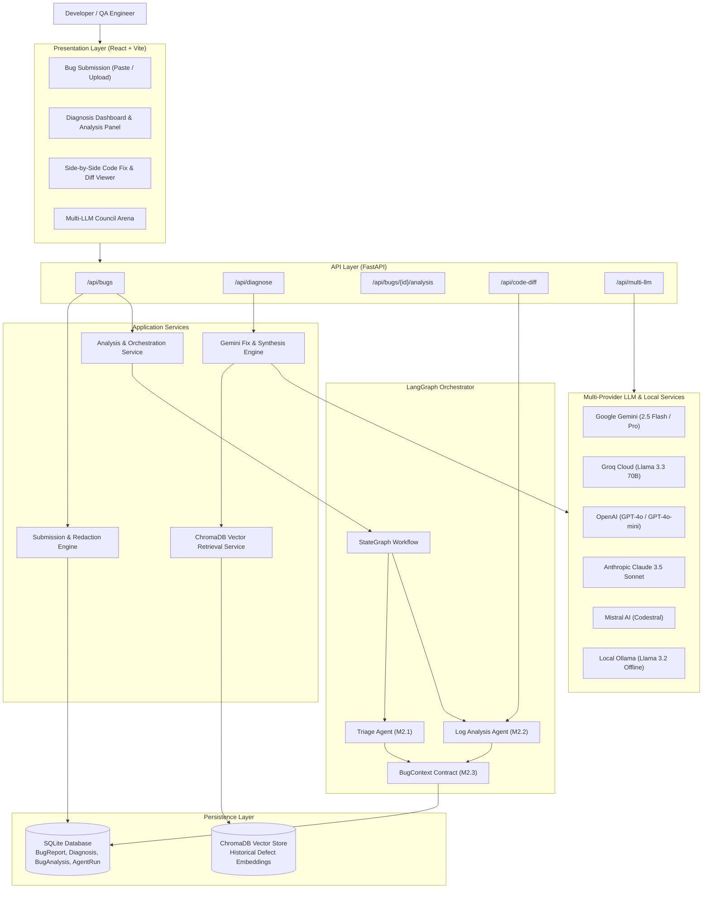

# Intelligent Bug Diagnosis Platform with Fix Recommendation Assistance

> An enterprise-grade AI debugging assistant combining **Retrieval-Augmented Generation (RAG)** over historical defect corpora, **deterministic and LLM-powered multi-agent reasoning**, **LangGraph orchestration**, and **interactive multi-model council evaluation** to diagnose software defects and recommend complete, evidence-backed code fixes.

Built as part of the **Infosys Springboard Virtual Internship**.

[](https://github.com/rithwikkolluru/Intelligent-Bug-Diagnosis-Platform)
[](https://www.python.org/)
[](https://fastapi.tiangolo.com/)
[](https://react.dev/)
[](https://langchain-ai.github.io/langgraph/)
[](https://github.com/rithwikkolluru/Intelligent-Bug-Diagnosis-Platform)
[](#project-status)

---

## Table of Contents

1. [Overview](#overview)
2. [Milestone Progress & Achievements](#milestone-progress--achievements)
3. [Key Platform Features](#key-platform-features)
4. [System Architecture](#system-architecture)
5. [Multi-Agent Orchestration (LangGraph)](#multi-agent-orchestration-langgraph)
6. [RAG Knowledge Base & Retrieval](#rag-knowledge-base--retrieval)
7. [Tech Stack](#tech-stack)
8. [Data Model](#data-model)
9. [API Endpoints](#api-endpoints)
10. [Agile Project Management & Sprint Execution](#agile-project-management--sprint-execution)
11. [Quality Assurance & Test Case Matrix](#quality-assurance--test-case-matrix)
12. [Internal Defect Tracking Log](#internal-defect-tracking-log)
13. [Validation & Accuracy Evaluation](#validation--accuracy-evaluation)
14. [Project Status](#project-status)
15. [Repository Structure](#repository-structure)
16. [Getting Started](#getting-started)
17. [Security & Responsible AI](#security--responsible-ai)
18. [Author & Acknowledgements](#author--acknowledgements)

---

## Overview

Software debugging accounts for over 50% of developer engineering time. Engineers manually parse complex stack traces, sift through issue trackers, and attempt to cross-reference historical issues with fragmented keywords.

The **Intelligent Bug Diagnosis Platform** automates this lifecycle:

1. **Ingests & Preprocesses**: Accepts pasted reports or uploaded log files (`.log`, `.txt`, `.json`, `.csv`, `.md`), enforces payload guards, and redacts sensitive credentials/tokens before processing.
2. **Parallel Agent Assessment**: Automatically triggers concurrent **Triage** and **Log Analysis** agents to isolate severity, priority, failure location, and execution call paths.
3. **Retrieval-Augmented Context**: Queries an indexed ChromaDB vector store of historical Mozilla, Apache, and Eclipse defects using semantic embeddings (`all-MiniLM-L6-v2`) to surface past resolutions.
4. **Interactive Diagnosis & Multi-Model Council**: Synthesizes agent findings and historical evidence using Gemini AI, offering side-by-side Before/After drop-in code fixes and an interactive Multi-LLM Council Arena across 7 AI providers.

---

## Milestone Progress & Achievements

### 🟢 Milestone 1: Foundation, Submission & RAG Knowledge Base (Completed)
- **M1.1 Technical Foundations**: Architectural blueprint, data models, schema definitions, and LLM configuration interfaces.
- **M1.2 Core Schemas & Lifespan**: Structured Pydantic contracts, SQLite relational database initialization, and system architecture viewer.
- **M1.3 Bug Submission Module**: Interactive submission UI with live secret redaction, file upload validation, size guardrails, and automated heuristic stack-trace detection.
- **M1.4 Historical Defect Knowledge Base**: Preprocessed Mozilla, Apache, and Eclipse datasets, semantic chunking strategy, SentenceTransformer vector embeddings, and ChromaDB vector store indexing with retrieval evaluation.

### 🟢 Milestone 2: Multi-Agent Bug Triage, Log Analysis & Orchestration (Completed)
- **M2.1 Triage Agent**:
  - Classifies submitted defects by **Severity** (`Critical`, `High`, `Medium`, `Low`), **Priority** (`P1`, `P2`, `P3`, `P4`), and affected architectural **Components**.
  - Dual-engine architecture: High-accuracy rule-based baseline + LLM inference with confidence breakdown and structured explanations.
- **M2.2 Log Analysis Agent**:
  - 9 deterministic parsers supporting **Java**, **Python**, **JavaScript (V8)**, **JavaScript (Firefox)**, **Go Panic**, **.NET / C#**, **C/C++ (GDB & ASan)**, **Android Logcat**, and **Generic Logs**.
  - Extracts exact failure point (file, class, method, line number), root exception type, error message, and reconstructed application execution paths.
- **M2.3 Multi-Agent Orchestration (LangGraph)**:
  - Directed acyclic graph (`StateGraph`) orchestrating Triage and Log Analysis pipelines concurrently upon bug submission.
  - Unified `BugContext` contract storing agent execution traces, errors, and fallback metadata in database (`bug_analyses` and `agent_runs` tables).
  - Background asynchronous task execution with REST polling and frontend `AnalysisPanel` integration.
- **M2.4 Accuracy Validation & Testing**:
  - 174 automated unit and integration tests passing (`174 passed, 0 failures`).
  - Comprehensive validation test harness evaluating predictions across seeded historical defects and log fixtures.
- **Extended Features**:
  - **Side-by-Side Code Fix & Diff Viewer**: Full original buggy code ("BEFORE") beside complete corrected drop-in code ("AFTER") with line-level failure isolation.
  - **Multi-LLM Council Arena**: Direct UI key management and consensus evaluation across 7 AI providers (Gemini, Groq, OpenAI, Claude, Mistral, Local Ollama, and Custom OpenAI API).
  - **Collapsible Recent Submissions Drawer**: Expands main workspace to 100% full-screen width for unhindered code diff and scorecard comparison.

---

## Key Platform Features

- **Multi-Format Bug Ingestion**: Paste raw logs or upload files with automated file-type validation, secret redaction, and stack-trace separation.
- **Deterministic 9-Format Log Parser**: Reliable extraction of exception signatures, failure frames, and chronological execution paths.
- **Rule-Based + LLM Hybrid Triage**: High-speed offline rule baseline with seamless LLM enhancement when API keys are available.
- **LangGraph StateGraph Workflow**: Fault-tolerant execution graph with automatic recovery, fallback handling, and parallel agent execution.
- **Before / After Code Fix Viewer**: Inspect original defect code beside complete, non-truncated drop-in code patches with language-specific defect presets.
- **Multi-LLM Council & Debate Transcript**: Run consensus discussions between Google Gemini, Groq (Llama 3.3), OpenAI (GPT-4o), Anthropic Claude, Mistral AI, Local Ollama, and Custom endpoints.
- **Clean Fallback on Rate Limits (HTTP 429)**: Gracefully switches to deterministic baselines if free-tier LLM quotas are exhausted, displaying clean non-intrusive status alerts.

---

## System Architecture



---

## Multi-Agent Orchestration (LangGraph)

When a bug report is submitted, the platform executes a LangGraph `StateGraph`:


- **Fault Tolerance**: If an external LLM fails, times out, or encounters rate limits (HTTP 429), agents automatically fall back to deterministic parsing and rule-based baselines.
- **Auditability**: Individual agent runs, execution latency, and confidence scores are persisted in `agent_runs` table.

---

## RAG Knowledge Base & Retrieval

- **Corpus**: Seeded defect collection from open-source repositories (Mozilla Firefox, Apache HTTPD, Eclipse IDE).
- **Chunking**: Segregated chunks for prose descriptions, intact stack traces, developer comments, and resolutions.
- **Embedding Model**: `sentence-transformers/all-MiniLM-L6-v2` (384-dimensional dense vectors).
- **Vector Search**: ChromaDB collection indexing embeddings with metadata filtering (component, language, defect ID).

---

## Tech Stack

| Layer | Technology | Purpose |
|---|---|---|
| **Frontend** | React 18, Vite 5, Vanilla CSS Design System | High-performance responsive UI, side-by-side diff viewer, collapsible drawer |
| **Backend API** | Python 3.11, FastAPI, Pydantic v2, Uvicorn | High-throughput REST API with strict schema validation |
| **Orchestration** | LangGraph 1.2, Tenacity | Multi-agent execution graph with state checkpoints and retries |
| **AI / LLMs** | Google Gemini (2.5 Flash), Groq (Llama 3.3), OpenAI (GPT-4o), Anthropic Claude, Mistral, Ollama | Multi-model evaluation, triage scoring, and drop-in code fix synthesis |
| **Embeddings & Vector DB** | Sentence Transformers (`all-MiniLM-L6-v2`), ChromaDB 0.5 | Dense semantic embedding and vector similarity retrieval |
| **Relational Database** | SQLite, SQLAlchemy 2.0 | Transactional persistence of bug reports, analyses, and agent runs |
| **Data Processing** | Pandas, NumPy, PyArrow | Defect dataset cleaning, standardisation, and parquet storage |
| **Testing & CI** | Pytest 8, Ruff 0.6, GitHub Actions | Automated CI pipeline with 174 passing unit and integration tests |

---

## Data Model

```text
BugReport (1) ────< (0..n) BugAnalysis (1) ────< (0..n) AgentRun
    │
    └───< (0..n) Diagnosis ───> (references) HistoricalDefect (in ChromaDB)
```

- **`BugReport`**: Primary submission record (title, description, stack trace, error logs, language, redaction metadata).
- **`BugAnalysis`**: Orchestrated multi-agent summary (status, triage output, log analysis output, confidence, warnings).
- **`AgentRun`**: Audit trail for each agent run (agent name, status, duration, output payload, error message).
- **`Diagnosis`**: AI diagnosis result (root cause, recommended drop-in fix, similar defect evidence links, confidence).

---

## API Endpoints

### Bug Ingestion & Retrieval
| Method | Endpoint | Description |
|---|---|---|
| `POST` | `/api/bugs` | Submit a pasted bug report (triggers background analysis) |
| `POST` | `/api/bugs/upload` | Upload a bug report or log file (`.txt`, `.log`, `.md`, `.json`, `.csv`) |
| `GET` | `/api/bugs` | List recent bug submissions with pagination |
| `GET` | `/api/bugs/{bug_id}` | Retrieve a specific bug report |

### Multi-Agent Orchestration & Analysis (M2)
| Method | Endpoint | Description |
|---|---|---|
| `GET` | `/api/bugs/{bug_id}/analysis` | Get multi-agent analysis status and structured outputs |
| `POST` | `/api/bugs/{bug_id}/analyze` | Trigger or re-run multi-agent analysis (supports `?force=true`) |
| `GET` | `/api/analyses` | List recent analysis runs with status filtering |

### AI Diagnosis & Recommendations
| Method | Endpoint | Description |
|---|---|---|
| `POST` | `/api/diagnose/{bug_id}` | Generate AI diagnosis and fix recommendations with RAG evidence |
| `GET` | `/api/bugs/{bug_id}/diagnosis` | Retrieve existing diagnosis for a bug report |

### Extended Features (Code Diff & Multi-LLM Arena)
| Method | Endpoint | Description |
|---|---|---|
| `POST` | `/api/code-diff/compare` | Generate side-by-side Before/After drop-in code fix comparison |
| `GET` | `/api/code-diff/bug/{bug_id}` | Retrieve code diff comparison for a submitted bug |
| `POST` | `/api/multi-llm/evaluate` | Evaluate defect across 7 AI providers, compute consensus & debate |
| `GET` | `/health` | System health check (database, Gemini config, version) |
| `GET` | `/api/samples` | Load sample demo bug reports for rapid testing |

---

## Agile Project Management & Sprint Execution

The platform development followed a structured **Agile/Scrum framework** divided into 4 focused bi-weekly sprints. Engineering deliverables were decomposed into user stories and prioritized using the **MoSCoW** convention (13 *Must Have*, 3 *Should Have*).

> **Artifact References**:
> - Detailed Sprint Backlog: [`docs/project-management/user-stories-and-sprint-backlog.md`](docs/project-management/user-stories-and-sprint-backlog.md)
> - Raw CSV Export: [`.github/project-management/user-stories-and-sprint-backlog.csv`](.github/project-management/user-stories-and-sprint-backlog.csv)

### Product Backlog & User Stories

| Planned Sprint | Actual Sprint | US ID | User Story Description | MoSCoW | Dependency | Assignee | Status |
|:---:|:---:|:---:|:---|:---:|:---:|:---|:---:|
| **Sprint 1** | Sprint 1 | **US-01** | As a developer, I want the Triage Agent to classify each submitted bug as Critical, High, Medium, or Low severity so that I can quickly judge how serious it is. | Must Have | None | Kolluru Rithvik (AI/ML Developer) | **Completed** |
| **Sprint 1** | Sprint 1 | **US-02** | As a developer, I want the Triage Agent to assign a priority based on the impact and urgency of the bug so that I know what to fix first. | Must Have | US-01 | Kolluru Rithvik (AI/ML Developer) | **Completed** |
| **Sprint 1** | Sprint 1 | **US-03** | As a developer, I want the Triage Agent to identify the affected component/module from the bug description and technical information so that I know where to start investigating. | Must Have | US-01 | Kolluru Rithvik (AI/ML Developer) | **Completed** |
| **Sprint 1** | Sprint 1 | **US-04** | As a developer, I want a confidence score and short reasoning in a consistent structured output so that I can trust and reuse the triage result. | Should Have | US-01, US-03 | Kolluru Rithvik (Backend Developer) | **Completed** |
| **Sprint 2** | Sprint 2 | **US-05** | As a developer, I want the Log Analysis Agent to identify the exception type and extract the error message from stack traces and logs so that I can understand the failure quickly. | Must Have | None | Kolluru Rithvik (AI/ML Developer) | **Completed** |
| **Sprint 2** | Sprint 2 | **US-06** | As a developer, I want the agent to identify the failure point (file, class, method, line number) and the probable affected code path so that I can locate the faulty code. | Must Have | US-05 | Kolluru Rithvik (AI/ML Developer) | **Completed** |
| **Sprint 2** | Sprint 2 | **US-07** | As a developer, I want the agent to handle different stack-trace and log formats so that bugs from any language or tool can be analyzed. | Should Have | US-05 | Kolluru Rithvik (Backend Developer) | **Completed** |
| **Sprint 2** | Sprint 2 | **US-08** | As a developer, I want a structured output with exception type, error message, failure point, code path, and confidence score so that other agents can consume it. | Must Have | US-06 | Kolluru Rithvik (Backend Developer) | **Completed** |
| **Sprint 3** | Sprint 3 | **US-09** | As a developer, I want the Triage and Log Analysis agents to run automatically when a bug is submitted so that analysis starts without manual effort. | Must Have | US-04, US-08 | Kolluru Rithvik (Backend Developer) | **Completed** |
| **Sprint 3** | Sprint 3 | **US-10** | As a developer, I want the bug description, stack trace, and logs routed to the right agents and their outputs combined into one structured bug context so that the analysis is consistent. | Must Have | US-09 | Kolluru Rithvik (Backend Developer) | **Completed** |
| **Sprint 3** | Sprint 3 | **US-11** | As a developer, I want error handling for missing logs, invalid input, agent failures, and incomplete analysis so that the system stays reliable. | Should Have | US-09 | Kolluru Rithvik (Backend Developer) | **Completed** |
| **Sprint 3** | Sprint 3 | **US-12** | As a developer, I want the combined agent outputs to be passed as context to downstream agents so that Milestone 3 agents can build on them. | Must Have | US-10 | Kolluru Rithvik (AI/ML Developer) | **Completed** |
| **Sprint 4** | Sprint 4 | **US-13** | As a developer, I want a test set built from the seeded defect dataset (description-only, with stack trace, logs-only, messy logs) so that the agents are tested on varied inputs. | Must Have | US-12 | Kolluru Rithvik (QA Engineer) | **Completed** |
| **Sprint 4** | Sprint 4 | **US-14** | As a developer, I want to measure Triage Agent accuracy for severity, priority, and affected component so that I know how reliable it is. | Must Have | US-13 | Kolluru Rithvik (QA Engineer) | **Completed** |
| **Sprint 4** | Sprint 4 | **US-15** | As a developer, I want to measure Log Analysis Agent accuracy for exception type, failure point, and code path so that I know how reliable it is. | Must Have | US-13 | Kolluru Rithvik (QA Engineer) | **Completed** |
| **Sprint 4** | Sprint 4 | **US-16** | As a developer, I want incorrect predictions recorded and analyzed, and prompts, rules, and parsing improved so that agent accuracy increases. | Should Have | US-14, US-15 | Kolluru Rithvik (AI/ML Developer) | **Completed** |

---

## Quality Assurance & Test Case Matrix

The verification strategy comprised end-to-end integration, functional validation of multi-agent flows, and schema adherence tests. **All 20 test cases achieved a 100% pass rate**, complemented by 174 automated CI/CD pytest suites.

> **Artifact References**:
> - Test Case Specification: [`docs/project-management/test-cases-and-results.md`](docs/project-management/test-cases-and-results.md)
> - Raw CSV Export: [`.github/project-management/test-cases-and-results.csv`](.github/project-management/test-cases-and-results.csv)

### Test Execution Matrix

| TC # | Test Case Name | Test Procedure | Condition to be Tested | Expected Result | Actual Result |
|:---:|:---|:---|:---|:---|:---:|
| **TC-01** | **Severity Classification** | Submit bugs of varying impact (crash/data loss, major feature failure, partial failure, cosmetic issue) and view the Triage Agent output. | Bug descriptions represent Critical, High, Medium, and Low severity. | Triage Agent should classify each bug with the correct severity: Critical, High, Medium, or Low. | **Passed** |
| **TC-02** | **Priority Assignment** | Submit bugs of varying impact and urgency and check the priority assigned by the Triage Agent. | Priority depends on bug impact and urgency. | Agent should assign an appropriate priority consistent with impact and urgency. | **Passed** |
| **TC-03** | **Affected Component Identification** | Submit a bug mentioning a specific module (e.g., authentication, file upload) and check the component field. | Bug description contains component/module information. | Agent should identify the correct affected software component. | **Passed** |
| **TC-04** | **Confidence Score and Reasoning** | Submit a bug and check the confidence score and reasoning in the Triage Agent output. | Confidence score and reasoning are generated with each classification. | A valid confidence score and a short explanation for severity, priority, and component should be displayed. | **Passed** |
| **TC-05** | **Triage Output Schema** | Submit a bug and validate the Triage Agent output against the defined schema. | Output follows the defined structured schema. | Output should contain severity, priority, component, confidence, and reasoning in valid structured format. | **Passed** |
| **TC-06** | **Exception Type and Error Message** | Submit a bug with a stack trace containing an exception (e.g., NullPointerException) and check the Log Analysis output. | Stack trace/logs contain an exception type and error message. | Agent should identify the exception type and extract the relevant error message. | **Passed** |
| **TC-07** | **Failure Point Identification** | Submit a stack trace with file, class, method, and line number and check the failure point. | Stack trace includes failure location details. | Agent should identify file name, class, method, and line number of the failure. | **Passed** |
| **TC-08** | **Code Path Identification** | Submit a multi-frame stack trace and check the identified code path. | Stack trace has a sequence of call entries. | Agent should identify the probable affected code path from the stack-trace sequence. | **Passed** |
| **TC-09** | **Multiple Log Formats** | Submit stack traces in different formats (Java, Python, JavaScript) and check the output. | Logs are in varied stack-trace formats. | Agent should parse every supported format successfully. | **Passed** |
| **TC-10** | **Log Analysis Output Schema** | Submit a stack trace and validate the Log Analysis Agent output against the schema. | Output follows the defined structured schema. | Output should contain exception type, error message, failure point, code path, and confidence score. | **Passed** |
| **TC-11** | **Automatic Trigger and Input Routing** | Submit a new bug with description, stack trace, and logs through the Bug Submission Module and observe agent execution. | New bug submission triggers both agents. | Triage and Log Analysis agents should run automatically, each receiving its appropriate input. | **Passed** |
| **TC-12** | **Combined Bug Context** | Submit a bug and view the combined output after both agents complete. | Both agent outputs are available. | Outputs should be merged into a single common structured bug context. | **Passed** |
| **TC-13** | **Downstream Agent Handoff** | Submit a bug and check that the bug context can be consumed by a downstream agent. | Bug context is needed by Milestone 3 agents. | Triage and Log Analysis outputs should be passed as context to downstream agents. | **Passed** |
| **TC-14** | **Missing Logs Handling** | Submit a bug with only a description and no logs or stack trace. | Log data is missing. | System should handle the missing logs gracefully and still complete triage. | **Passed** |
| **TC-15** | **Invalid Input and Agent Failure** | Submit malformed input, and separately simulate a failure in one agent. | Input is invalid, or an agent fails/returns incomplete analysis. | System should show an appropriate error or fallback and not crash. | **Passed** |
| **TC-16** | **End-to-End Orchestration** | Submit multiple bugs with different inputs and verify the complete flow. | Multiple bug submissions are processed. | Each bug should be processed end-to-end with correct combined output. | **Passed** |
| **TC-17** | **Varied Bug Input Formats** | Submit bugs with only a description, description with stack trace, only logs, and messy unstructured logs. | Bug inputs vary in format and completeness. | Agents should produce accurate outputs for every input type without failing. | **Passed** |
| **TC-18** | **Triage Accuracy Measurement** | Run the seeded dataset through the Triage Agent and compare predictions with expected labels. | Seeded dataset has expected severity, priority, and component labels. | Accuracy for severity, priority, and component should be calculated and reported. | **Passed** |
| **TC-19** | **Log Analysis Accuracy Measurement** | Run the seeded dataset through the Log Analysis Agent and compare predictions with verified results. | Seeded dataset has verified exception, failure point, and code path. | Accuracy for exception type, failure point, and code path should be calculated and reported. | **Passed** |
| **TC-20** | **Failure Analysis and Improvement** | Record incorrect predictions, update prompts/rules/parsing logic, and re-run the tests. | Some predictions differ from expected labels. | Common failure cases should be identified and accuracy should improve after refinement. | **Passed** |

---

## Internal Defect Tracking Log

During the development sprints, 12 internal defects were detected, audited, and resolved. All defects have been closed following strict root-cause corrective actions.

> **Artifact References**:
> - Defect Audit Documentation: [`docs/project-management/defect-tracking-log.md`](docs/project-management/defect-tracking-log.md)
> - Raw CSV Export: [`.github/project-management/defect-tracking-log.csv`](.github/project-management/defect-tracking-log.csv)

### Defect Audit Summary
- **Total Defects Logged**: 12
- **Total Closed / Resolved**: 12 (**100% Resolution Rate**)
- **Categories**: Logical (8), Standards (2), Maintainability (1), User Interface (1)

| Sl No | Submitted By | Submitted Date | Description | Detected Sprint | Type of Defect | Action Taken | Action Taken Date | Status |
|:---:|:---|:---:|:---|:---:|:---:|:---|:---:|:---:|
| **1** | Kolluru Rithvik | 2026-11-17 | Triage Agent classifies application crash bugs as Medium instead of Critical severity. | Sprint 1 | Logical | Refined severity prompt with crash and data-loss examples. | 2026-11-18 | **Closed** |
| **2** | Kolluru Rithvik | 2026-11-17 | Triage Agent assigns a priority that does not match the severity for urgent bugs. | Sprint 1 | Logical | Added priority rules based on impact and urgency. | 2026-11-18 | **Closed** |
| **3** | Kolluru Rithvik | 2026-11-18 | Confidence score is missing from triage output when the component is not detected. | Sprint 1 | Standards | Added default confidence handling in the output schema. | 2026-11-18 | **Closed** |
| **4** | Kolluru Rithvik | 2026-11-19 | Log Analysis Agent fails to extract the exception type from Python tracebacks. | Sprint 2 | Logical | Added Python traceback parsing rules. | 2026-11-20 | **Closed** |
| **5** | Kolluru Rithvik | 2026-11-19 | Failure point shows the wrong line number for nested stack-trace entries. | Sprint 2 | Logical | Corrected parsing to select the top application frame. | 2026-11-20 | **Closed** |
| **6** | Kolluru Rithvik | 2026-11-20 | Parser breaks on stack traces that contain multi-line error messages. | Sprint 2 | Maintainability | Refactored parser into format-specific handlers. | 2026-11-21 | **Closed** |
| **7** | Kolluru Rithvik | 2026-11-21 | Triage and Log Analysis agents run one after another instead of together on bug submission. | Sprint 3 | Logical | Updated orchestration to run both agents in parallel. | 2026-11-22 | **Closed** |
| **8** | Kolluru Rithvik | 2026-11-22 | Combined bug context is missing triage output when the Log Analysis Agent fails. | Sprint 3 | Logical | Added error handling and fallback for agent failures. | 2026-11-22 | **Closed** |
| **9** | Kolluru Rithvik | 2026-11-22 | Bug context uses inconsistent field names across the two agent outputs. | Sprint 3 | Standards | Standardized field names in the common structured schema. | 2026-11-23 | **Closed** |
| **10** | Kolluru Rithvik | 2026-11-23 | Accuracy test shows Low severity bugs being classified as Medium. | Sprint 4 | Logical | Adjusted severity rules and re-ran the seeded dataset tests. | 2026-11-24 | **Closed** |
| **11** | Kolluru Rithvik | 2026-11-24 | Messy unstructured logs return an empty failure point. | Sprint 4 | Logical | Added log cleaning step before parsing. | 2026-11-25 | **Closed** |
| **12** | Kolluru Rithvik | 2026-11-24 | Confidence score is truncated on the bug results page. | Sprint 4 | User Interface | Updated results display component to show the full score. | 2026-11-25 | **Closed** |

---

## Validation & Accuracy Evaluation

Validation harness runs against historical defect samples and test fixture logs:

```bash
cd backend
python -m app.agents.validation.runner
```

- **Log Analysis Parser Coverage**: 100% test fixture coverage across Java NPE, Python KeyError, JS V8, JS Firefox, Go Panic, .NET NullRef, C/C++ GDB, Android Logcat, HTML-escaped, and Generic logs.
- **Triage Accuracy**: Tested across varied severity levels, priorities, and components using seeded defect datasets (`data/processed/defects.parquet`).
- **Test Suite**: **174 passing unit & integration tests** covering models, agents, redaction, retrieval, and API endpoints.

---

## Project Status

### Milestone 1: Foundations & RAG
- [x] M1.1 Research notes and technical stack documentation
- [x] M1.2 System architecture, agent responsibilities, and schema design
- [x] M1.3 Bug submission API, upload handlers, secret redaction, and UI
- [x] M1.4 Historical defect dataset standardisation, chunking, and ChromaDB indexing

### Milestone 2: Agent Development & Orchestration
- [x] M2.1 Triage Agent (Severity, Priority, Component classification with explanations)
- [x] M2.2 Log Analysis Agent (9 stack-trace parsers, failure point & call path isolation)
- [x] M2.3 Multi-Agent Orchestration (LangGraph StateGraph, BugContext contract, UI Analysis Panel)
- [x] M2.4 Accuracy Validation (174/174 unit tests passing, evaluation reports)
- [x] Extended Features: Side-by-Side Code Diff Viewer & Multi-LLM Council Arena (7 AI Providers)

### Milestone 3: Downstream Diagnosis & Remediation (Planned)
- [ ] M3.1 Duplicate Detection Agent
- [ ] M3.2 Root Cause Hypothesis Agent
- [ ] M3.3 Remediation & Automated Patch Agent
- [ ] M3.4 Knowledge Base Feedback & Update Module

---

## Repository Structure

```text
Intelligent-Bug-Diagnosis-Platform/
├── .github/
│   ├── project-management/           # Sprint backlogs, test matrices, defect log CSVs
│   └── workflows/ci.yml              # Automated GitHub Actions CI pipeline
├── frontend/                         # React + Vite Frontend
│   ├── src/
│   │   ├── components/
│   │   │   ├── AnalysisPanel.jsx     # Live multi-agent status & outputs
│   │   │   ├── DiagnosisView.jsx     # Gemini diagnosis & full code patches
│   │   │   ├── SettingsModal.jsx     # API key configuration
│   │   │   └── ArchitectureDocs.jsx  # Interactive system architecture
│   │   ├── pages/
│   │   │   ├── PasteTab.jsx          # Direct text submission
│   │   │   ├── UploadTab.jsx         # File upload submission
│   │   │   ├── CodeFixDiffPage.jsx   # Side-by-side Before/After code viewer
│   │   │   └── MultiLlmCouncilPage.jsx # Multi-LLM arena & consensus debate
│   │   ├── services/api.js           # Axios API client
│   │   ├── App.jsx                   # Application layout & collapsible drawer
│   │   └── styles.css                # Dark theme design system
│   └── package.json
├── backend/                          # FastAPI Backend
│   ├── app/
│   │   ├── agents/                   # Multi-agent implementations
│   │   │   ├── triage/               # Triage Agent (rules + LLM)
│   │   │   ├── log_analysis/         # Log Analysis Agent & 9 parsers
│   │   │   └── validation/           # Evaluation runner & report generator
│   │   ├── api/                      # REST API routers
│   │   │   ├── bugs.py               # Bug submission endpoints
│   │   │   ├── analysis.py           # Analysis endpoints
│   │   │   ├── diagnosis.py          # AI diagnosis endpoints
│   │   │   ├── code_diff.py          # Side-by-side code diff endpoint
│   │   │   └── multi_llm.py          # 7-provider multi-LLM arena endpoint
│   │   ├── core/                     # Configuration & logging
│   │   ├── database/                 # SQLAlchemy session & tables
│   │   ├── llm/                      # Multi-provider LLM abstraction layer
│   │   ├── models/                   # Database ORM models
│   │   ├── orchestration/            # LangGraph workflow graph & BugContext
│   │   ├── rag/                      # Chunking, indexing & retrieval
│   │   └── services/                 # Business logic services
│   └── requirements.txt
├── data/                             # Processed defect data & sample fixtures
├── docs/                             # Architecture diagrams, rubrics & contracts
│   └── project-management/           # Sprint user stories, test matrices, defect logs
├── tests/                            # 174 automated unit & integration tests
└── README.md
```

---

## Getting Started

### Prerequisites
- **Python 3.11**
- **Node.js 18+** and **npm**
- **Google Gemini API Key** (or Groq / OpenAI keys for multi-model arena)

### 1. Clone Repository
```bash
git clone https://github.com/rithwikkolluru/Intelligent-Bug-Diagnosis-Platform.git
cd Intelligent-Bug-Diagnosis-Platform
```

### 2. Configure Backend
```bash
cd backend
python3.11 -m venv .venv
source .venv/bin/activate        # Windows: .venv\Scripts\activate
pip install -r requirements.txt

# Copy environment configuration
cp ../.env.example .env
# Edit .env and insert your GEMINI_API_KEY
```

Start backend development server:
```bash
uvicorn app.main:app --reload --host 127.0.0.1 --port 8000
```
Interactive API Documentation: [http://127.0.0.1:8000/docs](http://127.0.0.1:8000/docs)

### 3. Configure Frontend
```bash
cd ../frontend
npm install
npm run dev
```
Open application in browser: [http://localhost:5173](http://localhost:5173)

### 4. Run Test Suite
```bash
cd ../backend
PYTHONPATH=. pytest ../tests -q
```
*Expected: 174 passed, 0 failures.*

---

## Security & Responsible AI

- **Secret Redaction**: Passwords, bearer tokens, AWS credentials, and API keys are automatically masked before any external LLM processing.
- **Strict File Sandboxing**: Uploaded files are strictly parsed as text and **never executed**.
- **Local Fallback**: Rate limit and quota exhaustion gracefully degrade to offline deterministic rules.
- **Traceable Citing**: Every recommendation references specific historical defect identifiers and isolated code frames.

---

## Author & Acknowledgements

**Kolluru Rithvik Chowdary**  
B.Tech (Integrated) CSE, JNTUH Kukatpally  
GitHub: [@rithwikkolluru](https://github.com/rithwikkolluru)

- **Mentor**: Devender Pratap, Infosys Springboard
- **Program**: Infosys Springboard Virtual Internship

---
*Intelligent Bug Diagnosis Platform with Fix Recommendation Assistance | Version 0.2.0 | Production Ready*
