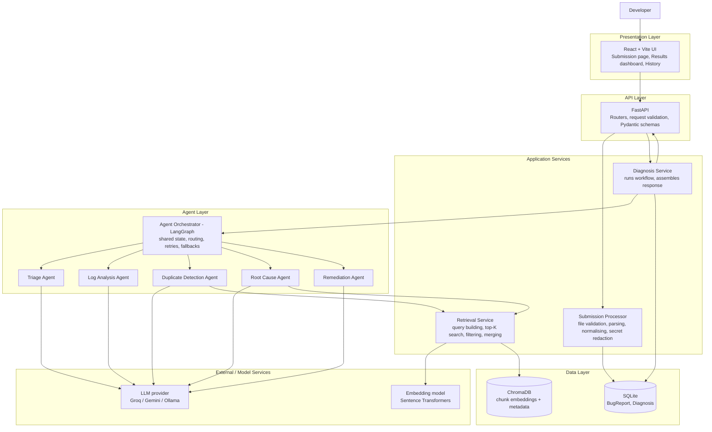
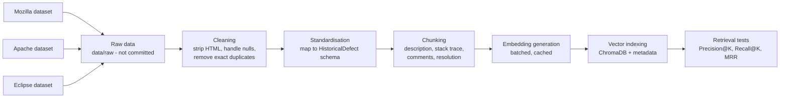
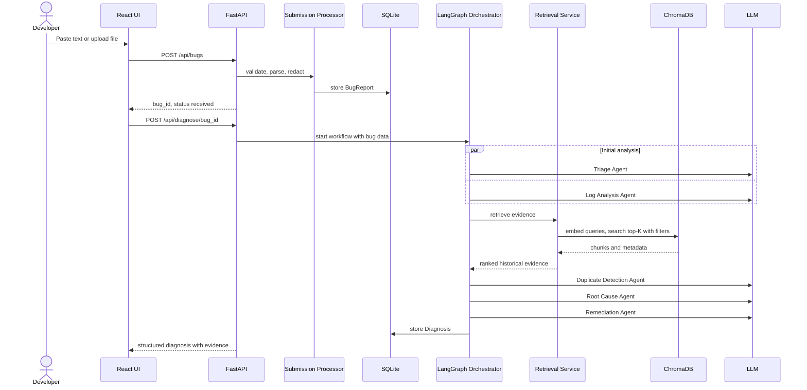
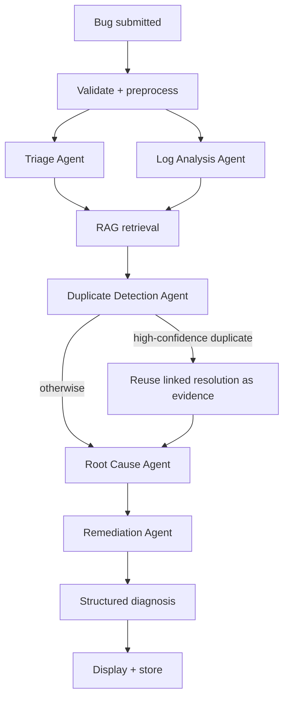

# Intelligent Bug Diagnosis Platform with Fix Recommendation Assistance

> An AI-powered debugging assistant that combines **Retrieval-Augmented Generation (RAG)**, **semantic search over historical defects** and **multi-agent orchestration** to diagnose software bugs and recommend evidence-backed fixes.

Built as part of the **Infosys Springboard Virtual Internship**.

---

## Table of Contents

1. [Overview](#overview)
2. [Key Features](#key-features)
3. [System Architecture](#system-architecture)
4. [Agents and Orchestration](#agents-and-orchestration)
5. [RAG Pipeline](#rag-pipeline)
6. [Tech Stack](#tech-stack)
7. [Data Model](#data-model)
8. [Datasets](#datasets)
9. [Bug Submission Module](#bug-submission-module)
10. [API Endpoints](#api-endpoints-planned)
11. [Evaluation Strategy](#evaluation-strategy)
12. [Roadmap and Milestones](#roadmap-and-milestones)
13. [Project Status](#project-status)
14. [Repository Structure](#repository-structure)
15. [Getting Started](#getting-started)
16. [Security and Responsible AI](#security-and-responsible-ai)
17. [Future Enhancements](#future-enhancements)
18. [Author](#author)

---

## Overview

Debugging is slow. Developers read stack traces, search issue trackers and compare against past defects by hand. Keyword search often misses related bugs that are described in different words.

This platform lets a developer **paste or upload** a bug report, stack trace or error log. It then:

1. Parses and classifies the problem.
2. Retrieves **semantically similar historical defects** from a knowledge base built on Mozilla, Apache and Eclipse bug data.
3. Detects likely duplicates.
4. Proposes root-cause hypotheses.
5. Recommends fixes, **citing the historical evidence** each suggestion is based on.

**Design principle:** every diagnosis separates *retrieved evidence* from *AI-generated conclusions*, and states uncertainty when evidence is weak. Suggested fixes are treated as unverified until tested.

## Key Features

- Bug submission by direct paste or file upload (`.txt`, `.log`, `.md`, `.json`, `.csv`)
- Historical defect knowledge base (Mozilla, Apache, Eclipse)
- Semantic retrieval of similar bugs with metadata filtering
- Five specialised agents coordinated by LangGraph
- Structured diagnosis: root causes, similar defects, fixes, validation steps, confidence
- Input validation, file-type restrictions and secret redaction before LLM calls

---

## System Architecture

### 1. Architectural Principles

| Principle | What it means in this project |
|---|---|
| **Layered design** | UI, API, services, agents and data stores are separate layers; each talks only to the layer next to it. |
| **Two pipelines** | An *offline* pipeline builds the knowledge base. An *online* pipeline diagnoses submitted bugs. They share the vector store and schemas. |
| **Evidence first** | Agents receive retrieved historical defects as context and must cite them. Retrieved facts and AI conclusions are stored separately. |
| **Structured contracts** | Every agent returns typed JSON (Pydantic schemas), so outputs can be validated, stored and displayed. |
| **Provider independence** | The LLM and embedding model sit behind interfaces and can be swapped without changing agent logic. |
| **Incremental delivery** | Milestone 1 delivers the foundation; later milestones plug into the same structure without redesign. |

### 2. High-Level Architecture



### 3. Offline Pipeline: Building the Knowledge Base (Milestone 1)

Run once per dataset sample, and again whenever new defects are added.



Outputs of each stage are saved (`data/processed/`) so the pipeline can be re-run from any step.

### 4. Online Pipeline: Request Flow



> The current implementation supports bug-report submission and an offline RAG index-building CLI. The diagnosis agents and an online semantic-search API are planned for later milestones.

### 5. Component Responsibilities

| Layer | Component | Responsibility | Technology | Milestone |
|---|---|---|---|---|
| Presentation | Submission page | Paste text, upload file, show validation errors | React, Vite | M1 |
| Presentation | Results dashboard | Root causes, similar defects with source links, fixes, confidence | React | M3 |
| API | Routers and schemas | Endpoints, request and response validation | FastAPI, Pydantic | M1 |
| Services | Submission Processor | Type and size checks, stack-trace detection, normalisation, redaction | Python | M1 |
| Services | Retrieval Service | Build queries, embed, search, filter, merge chunks per defect | Python, ChromaDB | M1 |
| Services | Diagnosis Service | Start workflow, collect output, persist diagnosis | Python | M2 |
| Agents | Orchestrator | Shared state, ordering, parallel and conditional steps, retries | LangGraph | M2 |
| Agents | Five agents | Triage, log analysis, duplicates, root cause, remediation | LangGraph nodes + LLM | M2 |
| Data | Relational store | Bug reports and diagnoses | SQLite, SQLAlchemy | M1 |
| Data | Vector store | Chunk embeddings and metadata | ChromaDB | M1 |
| Models | Embedding model | Text to vectors | Sentence Transformers | M1 |
| Models | LLM | Reasoning and generation | Groq / Gemini / Ollama | M2 |

### 6. Retrieval Design

The retrieval service does more than a single similarity search:

1. **Multiple queries per bug.** Separate queries are built from the description, the stack trace and the extracted error signature (exception type plus top frames), because each matches different chunk types.
2. **Chunk-type awareness.** Trace queries search trace chunks; description queries search description chunks; resolution chunks are fetched for the best-matching defects.
3. **Metadata filters.** Optional filters by project, component, severity or status narrow results.
4. **Merge by defect.** Chunk hits are grouped by `defect_id`, so the agents see one ranked list of defects with their best-matching chunks.
5. **Configurable top-K.** Default is 5, tuned during evaluation.
6. **Similarity is a signal, not a verdict.** Scores are passed to agents with the evidence; thresholds are chosen from evaluation results.

### 7. Shared Workflow State

All agents read from and write to one typed state object, which keeps the workflow traceable and easy to test.

| Field | Written by | Content |
|---|---|---|
| `bug` | Submission | Normalised `BugReport` |
| `triage` | Triage Agent | category, severity, priority, component, language |
| `log_findings` | Log Analysis Agent | exception type, key frames, error signature, summary |
| `evidence` | Retrieval Service | ranked historical defects, chunks, scores, source links |
| `duplicates` | Duplicate Detection Agent | candidate duplicates with rationale |
| `root_causes` | Root Cause Agent | hypotheses, supporting evidence IDs, confidence |
| `remediation` | Remediation Agent | fix steps, risks, validation steps, references |
| `errors` | Any node | failures and fallbacks taken |
| `status` | Orchestrator | pending, running, completed, partial, failed |

### 8. Error Handling and Fallbacks

| Failure | Behaviour |
|---|---|
| Unsupported, oversized or malformed upload | Rejected at the API with a clear error; nothing stored |
| Empty or very short bug report | Request rejected with guidance on what to add |
| No relevant historical matches | Diagnosis continues with a lower confidence and says no similar defects were found |
| LLM timeout or rate limit | Retry with backoff, then fall back to the next configured provider or local model |
| Invalid agent JSON | Validate against schema, retry once, otherwise mark that section as unavailable |
| One agent fails | Workflow returns a `partial` diagnosis with the other sections instead of failing entirely |

### 9. Key Design Decisions

| Decision | Choice | Reason |
|---|---|---|
| Separate chunk types | Description, trace, comments and resolution are indexed separately | Stack traces and prose match differently; resolutions are what remediation needs |
| Keep stack traces intact | No mid-trace splitting | A split trace loses the error pattern |
| Vector store | ChromaDB | Local, free, persistent, supports metadata filtering; easy to set up for a prototype |
| Embeddings | `all-MiniLM-L6-v2` first | Small and fast; compared against alternatives in evaluation |
| Orchestration | LangGraph | Explicit state, parallel and conditional edges, retries |
| Relational store | SQLite | Zero setup for development; can be replaced later |
| Retrieval before generation | RAG instead of fine-tuning | Knowledge can be updated without retraining and answers can cite sources |

### 10. Scalability and Deployment Path

| Concern | Prototype | Later option |
|---|---|---|
| Relational data | SQLite | PostgreSQL |
| Vector search | ChromaDB (local) | Qdrant or pgvector for larger collections |
| Long diagnoses | Synchronous request | Background task queue with status polling |
| Packaging | Local run | Docker and docker-compose (frontend, backend, vector store) |
| Observability | Logs | Structured logging, request tracing, per-agent timing |

> The architecture is refined as each milestone is delivered. The exported diagram (PNG/SVG) is kept in [`docs/diagrams/`](docs/diagrams/).

---

## Agents and Orchestration

| Agent | Responsibility | Output |
|---|---|---|
| **Triage** | Classify defect type, estimate severity and priority, identify component and language | category, severity, priority, component, language |
| **Log Analysis** | Extract exception types, key stack frames, file and line references, error patterns | exception, frames, error signature, summary |
| **Duplicate Detection** | Rank similar historical reports using retrieval plus content comparison | candidate duplicates, similarity, rationale |
| **Root Cause** | Form hypotheses from the submission, log findings and retrieved defects; separate symptoms from causes | hypotheses, evidence IDs, confidence |
| **Remediation** | Propose fixes from the root cause and historical resolutions, with risks and tests | fix steps, risks, validation steps, references |

**Orchestration flow**



> Semantic similarity alone is **not** treated as proof of a duplicate; the agent also compares the actual content, traces and metadata.

---

## RAG Pipeline

| Stage | What happens |
|---|---|
| 1. Collect | Download permitted samples of Mozilla, Apache and Eclipse datasets |
| 2. Clean | Strip HTML and boilerplate, handle missing values, remove exact duplicates, keep original IDs and source links |
| 3. Standardise | Map all sources to one `HistoricalDefect` schema |
| 4. Chunk | Separate chunks for description, stack trace, comments and resolution, each with metadata linking to its defect |
| 5. Embed | Sentence Transformers (`all-MiniLM-L6-v2` first; alternatives compared) |
| 6. Index | Store vectors plus metadata (defect ID, project, chunk type, severity, status) in ChromaDB |
| 7. Retrieve | Embed the new bug, return the top 5 chunks (configurable) using cosine similarity |
| 8. Diagnose | Pass evidence to the agents; output keeps retrieved facts and AI conclusions separate |

**Chunking rules:** stack traces are kept intact rather than split mid-trace; resolutions get their own chunk; chunk sizes will be tuned experimentally.

Later improvements: hybrid search (vector + BM25), metadata filtering, reranking.

---

## Tech Stack

| Layer | Technology | Purpose |
|---|---|---|
| Frontend | React.js + Vite | User interface |
| Backend | Python 3.11 + FastAPI | REST API |
| Orchestration | LangGraph | Multi-agent workflow |
| LLM | Provider-independent interface (Groq / Gemini free tiers; Ollama for local use) | Reasoning and generation |
| Embeddings | Sentence Transformers (`all-MiniLM-L6-v2`) | Semantic vectors |
| Vector DB | ChromaDB | Similarity search |
| Relational DB | SQLite (SQLAlchemy) | Reports and diagnosis records |
| Data processing | Pandas, NumPy | Cleaning and preprocessing |
| ML utilities | Scikit-learn | Evaluation |
| Testing | Pytest, Swagger UI | API and unit tests |
| CI | GitHub Actions | Lint and tests on every push |
| Containers | Docker | Planned for reproducible deployment |

Choices may change based on experiments, resource limits and mentor feedback. Decisions and comparisons are recorded in [`docs/tech-stack.md`](docs/tech-stack.md).

---

## Data Model

Full field definitions: [`docs/database-schema.md`](docs/database-schema.md).

| Entity | Purpose | Key fields |
|---|---|---|
| **BugReport** | Newly submitted bugs | `bug_id`, `title`, `description`, `stack_trace`, `error_logs`, `programming_language`, `source_type`, `status`, `created_at` |
| **HistoricalDefect** | Standardised historical bugs | `defect_id`, `project`, `summary`, `description`, `comments`, `resolution`, `severity`, `priority`, `status`, `source_url` |
| **BugChunk** | Indexed retrieval units | `chunk_id`, `defect_id`, `chunk_type`, `chunk_text`, `embedding_id`, `metadata` |
| **Diagnosis** | Workflow output | `diagnosis_id`, `bug_id`, `root_cause`, `similar_defects`, `recommended_fix`, `confidence`, `validation_steps`, `created_at` |

Relationships: one `HistoricalDefect` has many `BugChunk`s; one `BugReport` has one or more `Diagnosis` records that reference `HistoricalDefect` IDs as evidence.

---

## Datasets

| Source | Reference |
|---|---|
| Mozilla CORE dataset | https://zenodo.org/records/14229872 |
| Eclipse defect dataset | https://zenodo.org/records/15348468 |
| Apache / Mozilla defect research | https://doi.org/10.1145/3593802 |

- Dataset structure, licence and redistribution terms are checked before use, and attribution is recorded here.
- The full datasets are large, so development starts with a manageable sample.
- **Raw datasets are not committed to the repository.** See [`data/README.md`](data/README.md) for download and preprocessing steps.

---

## Bug Submission Module

**Direct input:** title, description, stack trace, error logs, language (optional).

**File upload:** `.txt`, `.log`, `.md`, `.json`, `.csv`.

Safeguards:

- Extension and content validation, size limit, input sanitisation
- Clear errors for unsupported or malformed files
- Uploaded files are **never executed**
- Passwords, tokens and API keys are redacted before any external LLM call

---

## API Endpoints

### Implemented

| Method | Endpoint | Description |
|---|---|---|
| `POST` | `/api/bugs` | Submit a pasted bug report |
| `POST` | `/api/bugs/upload` | Submit a bug report file |
| `GET` | `/api/bugs/{bug_id}` | Retrieve a stored bug report |
| `GET` | `/api/bugs` | List recent bug reports |
| `GET` | `/health` | Health check |

### Planned

| Method | Endpoint | Description |
|---|---|---|
| `POST` | `/api/search` | Semantic search over the knowledge base |
| `POST` | `/api/diagnose/{bug_id}` | Run the diagnosis workflow |
| `GET` | `/api/diagnoses/{diagnosis_id}` | Retrieve a diagnosis |

Interactive docs: `http://127.0.0.1:8000/docs` once the backend is running.

---

## Evaluation Strategy

Results will be documented from real measurements only.

| Area | What is measured |
|---|---|
| API | Valid and invalid submissions, oversized or malformed files, response structure |
| Data processing | Text extraction, missing values, duplicate handling, schema consistency, chunk and metadata integrity |
| Retrieval | **Precision@K, Recall@K, MRR** on a reviewed test set (bugs with known duplicate links serve as ground truth) |
| Duplicate detection | Precision, Recall, F1 on labelled pairs |
| Diagnosis quality | Error-pattern accuracy, evidence relevance, root-cause plausibility, fix relevance, traceability, honest uncertainty |
| Performance | Preprocessing, embedding and indexing time; retrieval latency; API and diagnosis response time |

Experiments planned: embedding model comparison (MiniLM vs BGE), chunk size variants, vector-only vs hybrid retrieval.

---

## Roadmap and Milestones

### Milestone 1: Foundation and Bug Understanding (current)

| ID | Task | Deliverables |
|---|---|---|
| **M1.1** | Research and technical understanding | Research notes on defect workflows, RAG, embeddings, dataset structures; technology choices |
| **M1.2** | System architecture | Architecture diagram, agent responsibilities, orchestration flow, schemas, data flow |
| **M1.3** | Bug Submission Module | Submission UI and API, paste and upload, validation, storage |
| **M1.4** | Historical Defect Knowledge Base | Cleaned datasets, chunking strategy, embeddings, ChromaDB index, retrieval tests |

### Milestone 2: Multi-Agent Diagnosis and RAG Integration
Implement the five agents, LangGraph orchestration, RAG integration, structured outputs, error handling and fallbacks.

### Milestone 3: Dashboard and End-to-End Integration
Diagnosis results UI, similar-defect evidence view, fix recommendations, diagnosis history, end-to-end tests.

### Milestone 4: Evaluation, Optimisation and Documentation
Labelled test set, retrieval and duplicate-detection metrics, latency measurements, hybrid retrieval and reranking experiments, final demo.

---

## Project Status

Update these only when the work is **finished and tested**.

**Milestone 1**

- [x] M1.1 Research and technical documentation
- [x] M1.2 System architecture and agent workflow documentation
- [x] M1.2 Database schema documentation
- [x] M1.3 Bug submission API and tests
- [x] M1.3 Frontend submission interface and production build
- [ ] M1.4 Real dataset collection and analysis
- [x] M1.4 Cleaning, standardisation, and chunking code with unit tests
- [ ] M1.4 Indexing real datasets in ChromaDB
- [ ] M1.4 Semantic retrieval evaluation on real data

**Later milestones:** multi-agent implementation (M2), end-to-end integration (M3), final evaluation (M4) - planned.

---

## Repository Structure

```text
intelligent-bug-diagnosis-platform/
├── frontend/                 # React + Vite app
│   └── src/ (components, pages, services, assets)
├── backend/
│   ├── app/
│   │   ├── api/              # routes
│   │   ├── core/             # config, settings
│   │   ├── models/           # ORM models
│   │   ├── schemas/          # Pydantic schemas
│   │   ├── services/         # submission, parsing, redaction
│   │   ├── agents/           # agent modules (Milestone 2)
│   │   ├── rag/              # chunking, embeddings, retrieval
│   │   ├── database/
│   │   └── main.py
│   └── requirements.txt
├── data/                     # raw/ (git-ignored), processed/, samples/
├── notebooks/                # dataset analysis, embedding experiments
├── docs/                     # research, architecture, diagrams, schemas
├── tests/
├── .github/workflows/        # CI
├── .env.example
├── .gitignore
├── LICENSE
└── README.md
```

Modules are added as each feature is implemented.

---

## Getting Started

### Prerequisites

- Python 3.11 (3.10+ should work, subject to dependency support)
- Node.js 18+ and npm
- Git
- An LLM provider key (Groq or Gemini) or a local Ollama install, once generation is integrated (Milestone 2)

### 1. Clone

```bash
git clone https://github.com/rithwikkolluru/intelligent-bug-diagnosis-platform.git
cd intelligent-bug-diagnosis-platform
```

### 2. Backend

```bash
cd backend
python3.11 -m venv .venv
source .venv/bin/activate          # Windows: .venv\Scripts\activate
pip install -r requirements.txt
cp ../.env.example .env            # add your own keys; never commit .env
uvicorn app.main:app --reload
```

API docs: http://127.0.0.1:8000/docs

### 3. Frontend

```bash
cd frontend
npm install
npm run dev
```

### 4. Run tests

```bash
cd backend
pytest
```

### 5. Build the knowledge base (once the pipeline is implemented)

```bash
python -m app.rag.build_index
```

Follow [`data/README.md`](data/README.md) to download the dataset samples first.

---

## Security and Responsible AI

- Validate uploads, restrict formats and apply size limits; never execute uploaded files
- Sanitise submitted text; redact secrets before external LLM calls
- Keep credentials in environment variables; exclude `.env` and local databases from Git
- Respect dataset licences and attribution; keep original source references
- Clearly separate retrieved facts from AI-generated conclusions
- Communicate uncertainty; treat fixes as suggestions until validated by tests

---

## Future Enhancements

- Hybrid keyword + semantic retrieval and cross-encoder reranking
- Support for more languages and frameworks
- GitHub Issues and other tracker integrations
- Source-code context and repository-level analysis
- Automated test and patch generation with developer approval
- Feedback loop to improve retrieval and recommendations
- Docker deployment, authentication and role-based access
- Larger historical defect collections

---

## Author

**Kolluru Rithvik Chowdary**
B.Tech (Integrated) CSE, JNTUH Kukatpally
GitHub: [@rithwikkolluru](https://github.com/rithwikkolluru)

**Mentor:** Devender Pratap, Infosys Springboard
**Program:** Infosys Springboard Virtual Internship

## License

Released under the MIT License. See [`LICENSE`](LICENSE).

---

**Project:** Intelligent Bug Diagnosis Platform with Fix Recommendation Assistance | **Version:** 0.1.0 | **Domain:** AI, Software Engineering, Automated Debugging, RAG
