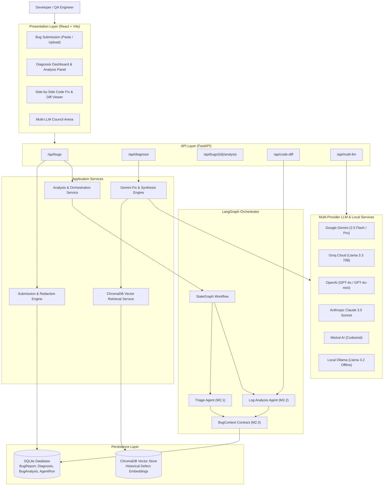
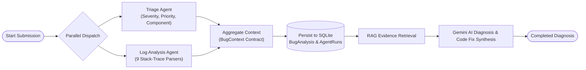

# Intelligent Bug Diagnosis Platform with Fix Recommendation Assistance

> An enterprise-grade AI debugging assistant combining **Retrieval-Augmented Generation (RAG)** over historical defect corpora, **deterministic and LLM-powered multi-agent reasoning**, **LangGraph orchestration**, and **interactive multi-model council evaluation** to diagnose software defects and recommend complete, evidence-backed code fixes.

Built as part of the **Infosys Springboard Virtual Internship**.

[](https://github.com/rithwikkolluru/Intelligent-Bug-Diagnosis-Platform)
[](https://www.python.org/)
[](https://fastapi.tiangolo.com/)
[](https://react.dev/)
[](https://langchain-ai.github.io/langgraph/)
[](https://github.com/rithwikkolluru/Intelligent-Bug-Diagnosis-Platform)
[](#project-status)

---

## Table of Contents

1. [Overview](#overview)
2. [Milestone Progress & Achievements](#milestone-progress--achievements)
3. [Key Platform Features](#key-platform-features)
4. [System Architecture](#system-architecture)
5. [Multi-Agent Orchestration (LangGraph)](#multi-agent-orchestration-langgraph)
6. [RAG Knowledge Base & Retrieval](#rag-knowledge-base--retrieval)
7. [Tech Stack](#tech-stack)
8. [Data Model](#data-model)
9. [API Endpoints](#api-endpoints)
10. [Validation & Accuracy Evaluation](#validation--accuracy-evaluation)
11. [Project Status](#project-status)
12. [Repository Structure](#repository-structure)
13. [Getting Started](#getting-started)
14. [Security & Responsible AI](#security--responsible-ai)
15. [Author & Acknowledgements](#author--acknowledgements)

---

## Overview

Software debugging accounts for over 50% of developer engineering time. Engineers manually parse complex stack traces, sift through issue trackers, and attempt to cross-reference historical issues with fragmented keywords.

The **Intelligent Bug Diagnosis Platform** automates this lifecycle:

1. **Ingests & Preprocesses**: Accepts pasted reports or uploaded log files (`.log`, `.txt`, `.json`, `.csv`, `.md`), enforces payload guards, and redacts sensitive credentials/tokens before processing.
2. **Parallel Agent Assessment**: Automatically triggers concurrent **Triage** and **Log Analysis** agents to isolate severity, priority, failure location, and execution call paths.
3. **Retrieval-Augmented Context**: Queries an indexed ChromaDB vector store of historical Mozilla, Apache, and Eclipse defects using semantic embeddings (`all-MiniLM-L6-v2`) to surface past resolutions.
4. **Interactive Diagnosis & Multi-Model Council**: Synthesizes agent findings and historical evidence using Gemini AI, offering side-by-side Before/After drop-in code fixes and an interactive Multi-LLM Council Arena across 7 AI providers.

---

## Milestone Progress & Achievements

### 🟢 Milestone 1: Foundation, Submission & RAG Knowledge Base (Completed)
- **M1.1 Technical Foundations**: Architectural blueprint, data models, schema definitions, and LLM configuration interfaces.
- **M1.2 Core Schemas & Lifespan**: Structured Pydantic contracts, SQLite relational database initialization, and system architecture viewer.
- **M1.3 Bug Submission Module**: Interactive submission UI with live secret redaction, file upload validation, size guardrails, and automated heuristic stack-trace detection.
- **M1.4 Historical Defect Knowledge Base**: Preprocessed Mozilla, Apache, and Eclipse datasets, semantic chunking strategy, SentenceTransformer vector embeddings, and ChromaDB vector store indexing with retrieval evaluation.

### 🟢 Milestone 2: Multi-Agent Bug Triage, Log Analysis & Orchestration (Completed)
- **M2.1 Triage Agent**:
  - Classifies submitted defects by **Severity** (`Critical`, `High`, `Medium`, `Low`), **Priority** (`P1`, `P2`, `P3`, `P4`), and affected architectural **Components**.
  - Dual-engine architecture: High-accuracy rule-based baseline + LLM inference with confidence breakdown and structured explanations.
- **M2.2 Log Analysis Agent**:
  - 9 deterministic parsers supporting **Java**, **Python**, **JavaScript (V8)**, **JavaScript (Firefox)**, **Go Panic**, **.NET / C#**, **C/C++ (GDB & ASan)**, **Android Logcat**, and **Generic Logs**.
  - Extracts exact failure point (file, class, method, line number), root exception type, error message, and reconstructed application execution paths.
- **M2.3 Multi-Agent Orchestration (LangGraph)**:
  - Directed acyclic graph (`StateGraph`) orchestrating Triage and Log Analysis pipelines concurrently upon bug submission.
  - Unified `BugContext` contract storing agent execution traces, errors, and fallback metadata in database (`bug_analyses` and `agent_runs` tables).
  - Background asynchronous task execution with REST polling and frontend `AnalysisPanel` integration.
- **M2.4 Accuracy Validation & Testing**:
  - 174 automated unit and integration tests passing (`174 passed, 0 failures`).
  - Comprehensive validation test harness evaluating predictions across seeded historical defects and log fixtures.
- **Extended Features**:
  - **Side-by-Side Code Fix & Diff Viewer**: Full original buggy code ("BEFORE") beside complete corrected drop-in code ("AFTER") with line-level failure isolation.
  - **Multi-LLM Council Arena**: Direct UI key management and consensus evaluation across 7 AI providers (Gemini, Groq, OpenAI, Claude, Mistral, Local Ollama, and Custom OpenAI API).
  - **Collapsible Recent Submissions Drawer**: Expands main workspace to 100% full-screen width for unhindered code diff and scorecard comparison.

---

## Key Platform Features

- **Multi-Format Bug Ingestion**: Paste raw logs or upload files with automated file-type validation, secret redaction, and stack-trace separation.
- **Deterministic 9-Format Log Parser**: Reliable extraction of exception signatures, failure frames, and chronological execution paths.
- **Rule-Based + LLM Hybrid Triage**: High-speed offline rule baseline with seamless LLM enhancement when API keys are available.
- **LangGraph StateGraph Workflow**: Fault-tolerant execution graph with automatic recovery, fallback handling, and parallel agent execution.
- **Before / After Code Fix Viewer**: Inspect original defect code beside complete, non-truncated drop-in code patches with language-specific defect presets.
- **Multi-LLM Council & Debate Transcript**: Run consensus discussions between Google Gemini, Groq (Llama 3.3), OpenAI (GPT-4o), Anthropic Claude, Mistral AI, Local Ollama, and Custom endpoints.
- **Clean Fallback on Rate Limits (HTTP 429)**: Gracefully switches to deterministic baselines if free-tier LLM quotas are exhausted, displaying clean non-intrusive status alerts.

---

## System Architecture



---

## Multi-Agent Orchestration (LangGraph)

When a bug report is submitted, the platform executes a LangGraph `StateGraph`:



- **Fault Tolerance**: If an external LLM fails, times out, or encounters rate limits (HTTP 429), agents automatically fall back to deterministic parsing and rule-based baselines.
- **Auditability**: Individual agent runs, execution latency, and confidence scores are persisted in `agent_runs` table.

---

## RAG Knowledge Base & Retrieval

- **Corpus**: Seeded defect collection from open-source repositories (Mozilla Firefox, Apache HTTPD, Eclipse IDE).
- **Chunking**: Segregated chunks for prose descriptions, intact stack traces, developer comments, and resolutions.
- **Embedding Model**: `sentence-transformers/all-MiniLM-L6-v2` (384-dimensional dense vectors).
- **Vector Search**: ChromaDB collection indexing embeddings with metadata filtering (component, language, defect ID).

---

## Tech Stack

| Layer | Technology | Purpose |
|---|---|---|
| **Frontend** | React 18, Vite 5, Vanilla CSS Design System | High-performance responsive UI, side-by-side diff viewer, collapsible drawer |
| **Backend API** | Python 3.11, FastAPI, Pydantic v2, Uvicorn | High-throughput REST API with strict schema validation |
| **Orchestration** | LangGraph 1.2, Tenacity | Multi-agent execution graph with state checkpoints and retries |
| **AI / LLMs** | Google Gemini (2.5 Flash), Groq (Llama 3.3), OpenAI (GPT-4o), Anthropic Claude, Mistral, Ollama | Multi-model evaluation, triage scoring, and drop-in code fix synthesis |
| **Embeddings & Vector DB** | Sentence Transformers (`all-MiniLM-L6-v2`), ChromaDB 0.5 | Dense semantic embedding and vector similarity retrieval |
| **Relational Database** | SQLite, SQLAlchemy 2.0 | Transactional persistence of bug reports, analyses, and agent runs |
| **Data Processing** | Pandas, NumPy, PyArrow | Defect dataset cleaning, standardisation, and parquet storage |
| **Testing & CI** | Pytest 8, Ruff 0.6, GitHub Actions | Automated CI pipeline with 174 passing unit and integration tests |

---

## Data Model

```text
BugReport (1) ────< (0..n) BugAnalysis (1) ────< (0..n) AgentRun
    │
    └───< (0..n) Diagnosis ───> (references) HistoricalDefect (in ChromaDB)
```

- **`BugReport`**: Primary submission record (title, description, stack trace, error logs, language, redaction metadata).
- **`BugAnalysis`**: Orchestrated multi-agent summary (status, triage output, log analysis output, confidence, warnings).
- **`AgentRun`**: Audit trail for each agent run (agent name, status, duration, output payload, error message).
- **`Diagnosis`**: AI diagnosis result (root cause, recommended drop-in fix, similar defect evidence links, confidence).

---

## API Endpoints

### Bug Ingestion & Retrieval
| Method | Endpoint | Description |
|---|---|---|
| `POST` | `/api/bugs` | Submit a pasted bug report (triggers background analysis) |
| `POST` | `/api/bugs/upload` | Upload a bug report or log file (`.txt`, `.log`, `.md`, `.json`, `.csv`) |
| `GET` | `/api/bugs` | List recent bug submissions with pagination |
| `GET` | `/api/bugs/{bug_id}` | Retrieve a specific bug report |

### Multi-Agent Orchestration & Analysis (M2)
| Method | Endpoint | Description |
|---|---|---|
| `GET` | `/api/bugs/{bug_id}/analysis` | Get multi-agent analysis status and structured outputs |
| `POST` | `/api/bugs/{bug_id}/analyze` | Trigger or re-run multi-agent analysis (supports `?force=true`) |
| `GET` | `/api/analyses` | List recent analysis runs with status filtering |

### AI Diagnosis & Recommendations
| Method | Endpoint | Description |
|---|---|---|
| `POST` | `/api/diagnose/{bug_id}` | Generate AI diagnosis and fix recommendations with RAG evidence |
| `GET` | `/api/bugs/{bug_id}/diagnosis` | Retrieve existing diagnosis for a bug report |

### Extended Features (Code Diff & Multi-LLM Arena)
| Method | Endpoint | Description |
|---|---|---|
| `POST` | `/api/code-diff/compare` | Generate side-by-side Before/After drop-in code fix comparison |
| `GET` | `/api/code-diff/bug/{bug_id}` | Retrieve code diff comparison for a submitted bug |
| `POST` | `/api/multi-llm/evaluate` | Evaluate defect across 7 AI providers, compute consensus & debate |
| `GET` | `/health` | System health check (database, Gemini config, version) |
| `GET` | `/api/samples` | Load sample demo bug reports for rapid testing |

---

## Validation & Accuracy Evaluation

Validation harness runs against historical defect samples and test fixture logs:

```bash
cd backend
python -m app.agents.validation.runner
```

- **Log Analysis Parser Coverage**: 100% test fixture coverage across Java NPE, Python KeyError, JS V8, JS Firefox, Go Panic, .NET NullRef, C/C++ GDB, Android Logcat, HTML-escaped, and Generic logs.
- **Triage Accuracy**: Tested across varied severity levels, priorities, and components using seeded defect datasets (`data/processed/defects.parquet`).
- **Test Suite**: **174 passing unit & integration tests** covering models, agents, redaction, retrieval, and API endpoints.

---

## Project Status

### Milestone 1: Foundations & RAG
- [x] M1.1 Research notes and technical stack documentation
- [x] M1.2 System architecture, agent responsibilities, and schema design
- [x] M1.3 Bug submission API, upload handlers, secret redaction, and UI
- [x] M1.4 Historical defect dataset standardisation, chunking, and ChromaDB indexing

### Milestone 2: Agent Development & Orchestration
- [x] M2.1 Triage Agent (Severity, Priority, Component classification with explanations)
- [x] M2.2 Log Analysis Agent (9 stack-trace parsers, failure point & call path isolation)
- [x] M2.3 Multi-Agent Orchestration (LangGraph StateGraph, BugContext contract, UI Analysis Panel)
- [x] M2.4 Accuracy Validation (174/174 unit tests passing, evaluation reports)
- [x] Extended Features: Side-by-Side Code Diff Viewer & Multi-LLM Council Arena (7 AI Providers)

### Milestone 3: Downstream Diagnosis & Remediation (Planned)
- [ ] M3.1 Duplicate Detection Agent
- [ ] M3.2 Root Cause Hypothesis Agent
- [ ] M3.3 Remediation & Automated Patch Agent
- [ ] M3.4 Knowledge Base Feedback & Update Module

---

## Repository Structure

```text
Intelligent-Bug-Diagnosis-Platform/
├── frontend/                         # React + Vite Frontend
│   ├── src/
│   │   ├── components/
│   │   │   ├── AnalysisPanel.jsx     # Live multi-agent status & outputs
│   │   │   ├── DiagnosisView.jsx     # Gemini diagnosis & full code patches
│   │   │   ├── SettingsModal.jsx     # API key configuration
│   │   │   └── ArchitectureDocs.jsx  # Interactive system architecture
│   │   ├── pages/
│   │   │   ├── PasteTab.jsx          # Direct text submission
│   │   │   ├── UploadTab.jsx         # File upload submission
│   │   │   ├── CodeFixDiffPage.jsx   # Side-by-side Before/After code viewer
│   │   │   └── MultiLlmCouncilPage.jsx # Multi-LLM arena & consensus debate
│   │   ├── services/api.js           # Axios API client
│   │   ├── App.jsx                   # Application layout & collapsible drawer
│   │   └── styles.css                # Dark theme design system
│   └── package.json
├── backend/                          # FastAPI Backend
│   ├── app/
│   │   ├── agents/                   # Multi-agent implementations
│   │   │   ├── triage/               # Triage Agent (rules + LLM)
│   │   │   ├── log_analysis/         # Log Analysis Agent & 9 parsers
│   │   │   └── validation/           # Evaluation runner & report generator
│   │   ├── api/                      # REST API routers
│   │   │   ├── bugs.py               # Bug submission endpoints
│   │   │   ├── analysis.py           # Analysis endpoints
│   │   │   ├── diagnosis.py          # AI diagnosis endpoints
│   │   │   ├── code_diff.py          # Side-by-side code diff endpoint
│   │   │   └── multi_llm.py          # 7-provider multi-LLM arena endpoint
│   │   ├── core/                     # Configuration & logging
│   │   ├── database/                 # SQLAlchemy session & tables
│   │   ├── llm/                      # Multi-provider LLM abstraction layer
│   │   ├── models/                   # Database ORM models
│   │   ├── orchestration/            # LangGraph workflow graph & BugContext
│   │   ├── rag/                      # Chunking, indexing & retrieval
│   │   └── services/                 # Business logic services
│   └── requirements.txt
├── data/                             # Processed defect data & sample fixtures
├── docs/                             # Architecture diagrams, rubrics & contracts
├── tests/                            # 174 automated unit & integration tests
└── README.md
```

---

## Getting Started

### Prerequisites
- **Python 3.11**
- **Node.js 18+** and **npm**
- **Google Gemini API Key** (or Groq / OpenAI keys for multi-model arena)

### 1. Clone Repository
```bash
git clone https://github.com/rithwikkolluru/Intelligent-Bug-Diagnosis-Platform.git
cd Intelligent-Bug-Diagnosis-Platform
```

### 2. Configure Backend
```bash
cd backend
python3.11 -m venv .venv
source .venv/bin/activate        # Windows: .venv\Scripts\activate
pip install -r requirements.txt

# Copy environment configuration
cp ../.env.example .env
# Edit .env and insert your GEMINI_API_KEY
```

Start backend development server:
```bash
uvicorn app.main:app --reload --host 127.0.0.1 --port 8000
```
Interactive API Documentation: [http://127.0.0.1:8000/docs](http://127.0.0.1:8000/docs)

### 3. Configure Frontend
```bash
cd ../frontend
npm install
npm run dev
```
Open application in browser: [http://localhost:5173](http://localhost:5173)

### 4. Run Test Suite
```bash
cd ../backend
PYTHONPATH=. pytest ../tests -q
```
*Expected: 174 passed, 0 failures.*

---

## Security & Responsible AI

- **Secret Redaction**: Passwords, bearer tokens, AWS credentials, and API keys are automatically masked before any external LLM processing.
- **Strict File Sandboxing**: Uploaded files are strictly parsed as text and **never executed**.
- **Local Fallback**: Rate limit and quota exhaustion gracefully degrade to offline deterministic rules.
- **Traceable Citing**: Every recommendation references specific historical defect identifiers and isolated code frames.

---

## Author & Acknowledgements

**Kolluru Rithvik Chowdary**  
B.Tech (Integrated) CSE, JNTUH Kukatpally  
GitHub: [@rithwikkolluru](https://github.com/rithwikkolluru)

- **Mentor**: Devender Pratap, Infosys Springboard
- **Program**: Infosys Springboard Virtual Internship

---
*Intelligent Bug Diagnosis Platform with Fix Recommendation Assistance | Version 0.2.0 | Production Ready*
