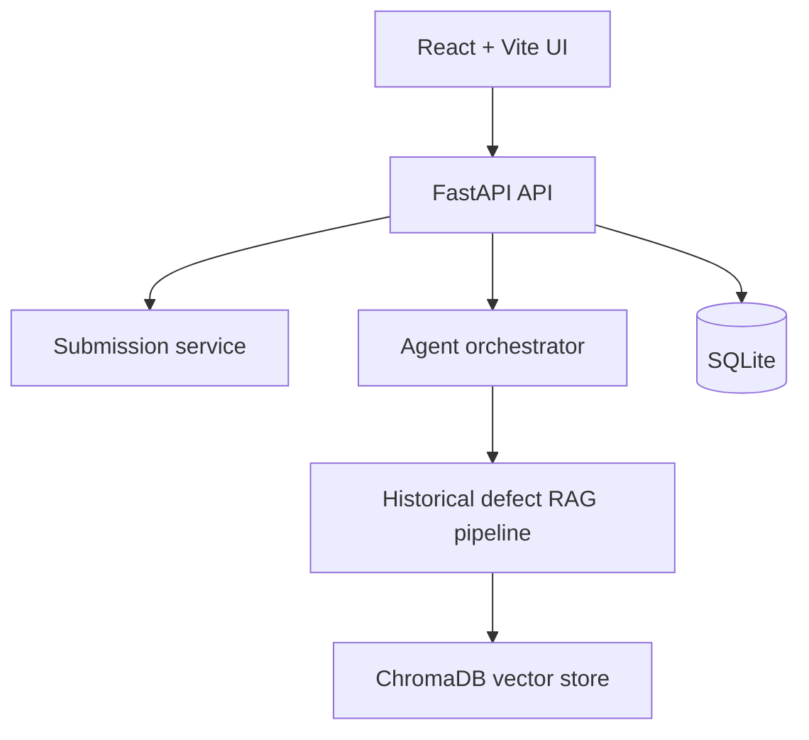

# Architecture

## System overview

The platform follows a layered architecture: frontend, API, services, agents, and data stores.

## Agent table

| Agent | Responsibility | Output |
| --- | --- | --- |
| Triage | Classify bug and gather signals | Initial problem summary |
| Log Analysis | Interpret stack traces and logs | Structured findings |
| Duplicate Detection | Compare against historical defects | Similarity + duplicate likelihood |
| Root Cause | Hypothesise the underlying issue | Cause and evidence |
| Remediation | Propose fixes and validation | Recommended fix steps |

## Historical defect pipeline change

The Milestone 1 code base has been extended with a RAG-oriented historical defect pipeline under `backend/app/rag/`. The implemented path is:

1. Source-specific loaders read raw dataset files from `data/raw/`.
2. Cleaning normalises text, strips HTML and boilerplate, and removes short/duplicate records.
3. Standardisation maps all project sources to `HistoricalDefect` with a consistent schema.
4. Chunking creates description, trace, comment and resolution chunks per defect.
5. Embedding produces deterministic vectors and optionally uses a sentence-transformers model when available.
6. Indexing stores chunks in ChromaDB and supports metadata filtering.

This differs from the original architecture by keeping the historical-defect index separate from the SQLite bug-report store and by making the retrieval layer source-aware, but still compatible with the existing FastAPI app.
